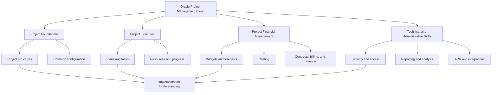
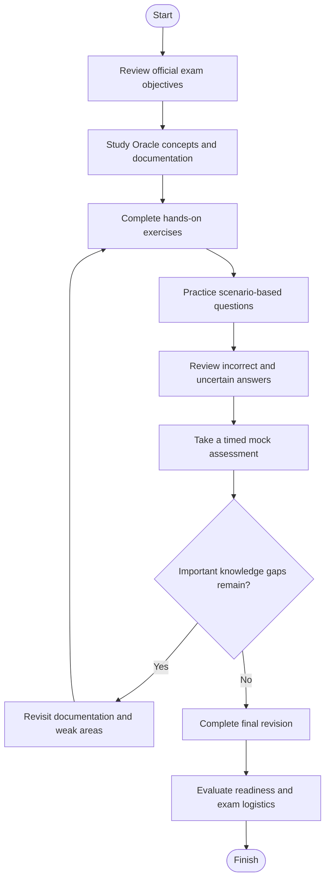
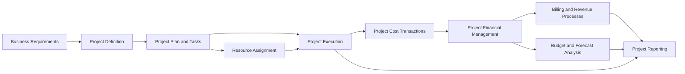
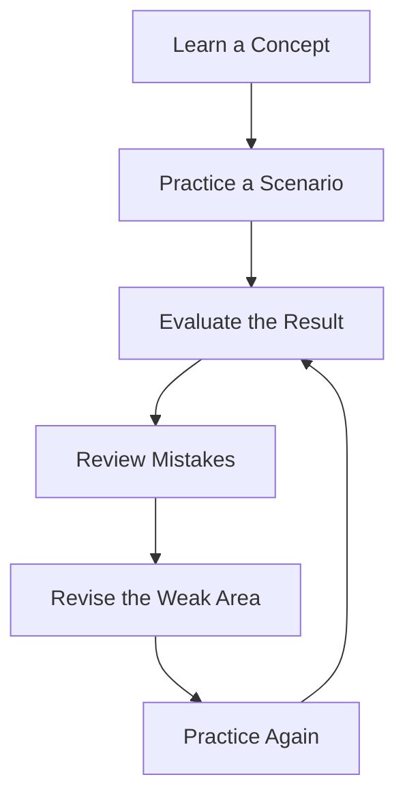
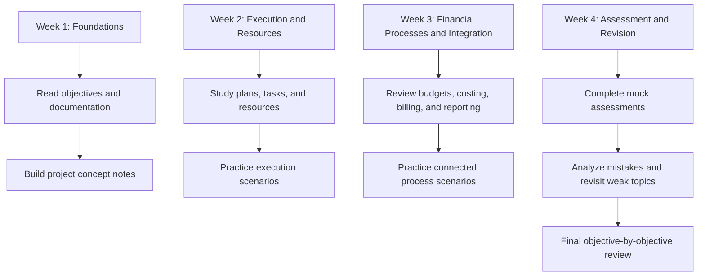

# Oracle Project Management Cloud 2026 Implementation Professional — 1Z0-1057-26

Prepare for the **Oracle Project Management Cloud 2026 Implementation Professional** certification with a structured study guide covering project planning, task management, resource management, project financials, costing, billing, reporting, configuration, and integration concepts.

This repository brings together a practical learning roadmap, Mermaid diagrams, implementation scenarios, study recommendations, and official Oracle documentation to help candidates prepare with a clear understanding of Oracle Fusion Cloud Project Management.

> **Exam code:** 1Z0-1057-26  
> **Certification:** Oracle Project Management Cloud 2026 Implementation Professional  
> **Official provider:** Oracle  
> **Preparation approach:** Official documentation + conceptual learning + practical exercises + practice questions + revision

---

## Table of Contents

- [Overview](#overview)
- [Exam Information](#exam-information)
- [Who Should Prepare?](#who-should-prepare-for-this-exam)
- [Oracle Project Management Cloud Overview](#oracle-project-management-cloud-overview)
- [Skills and Knowledge Areas](#skills-and-knowledge-areas)
- [Exam Objectives and Study Map](#exam-objectives-and-study-map)
- [Conceptual Skills Map](#conceptual-skills-map-not-official-exam-weighting)
- [Certification Preparation Flowchart](#certification-preparation-flowchart)
- [Technical Architecture Diagram](#technical-architecture-diagram)
- [Circular Study and Revision Cycle](#circular-study-and-revision-cycle)
- [Step-by-Step Preparation Guide](#step-by-step-preparation-guide)
- [Suggested Study Roadmap](#suggested-study-roadmap)
- [Practice Questions and Mock Tests](#practice-questions-and-mock-tests)
- [Hands-On Learning Projects](#hands-on-learning-projects)
- [Common Preparation Mistakes](#common-preparation-mistakes)
- [Career Relevance](#career-relevance)
- [Frequently Asked Questions](#frequently-asked-questions)
- [Official Learning Resources](#official-learning-resources)
- [Additional Preparation Resources](#additional-preparation-resources)
- [About CertsGate](#about-certsgate)

---

## Overview

Oracle Project Management Cloud supports organizations that need to plan work, assign resources, manage project tasks, track progress, and connect project activities with financial processes.

The 1Z0-1057-26 certification is relevant to professionals who work with Oracle Fusion Cloud Project Management implementation and related project processes.

Preparing for this certification involves more than learning product terminology. Candidates should understand how business requirements translate into application configuration, how project information moves through connected processes, and how to analyze the results of configuration choices.

This repository provides an independent **1Z0-1057-26 study guide** with a focus on:

- Understanding Oracle Project Management Cloud capabilities.
- Learning project execution and financial management concepts.
- Reviewing configuration and implementation documentation.
- Practicing realistic business scenarios.
- Identifying and revising weak areas.
- Developing confidence through structured assessment.

For supplementary certification preparation, visit [CertsGate](https://certsgate.com/). Use any relevant preparation materials alongside Oracle's official documentation and practical learning resources.

## Exam Information

The following details are based on Oracle certification information available for the 2026 exam.

| Item | Information |
|---|---|
| Exam code | 1Z0-1057-26 |
| Certification name | Oracle Project Management Cloud 2026 Implementation Professional |
| Certification provider | Oracle |
| Exam delivery | Proctored online |
| Exam format | Hands-on performance-based |
| Duration | 90 minutes |
| Number of questions | 36 |
| Passing score | 68% |
| Recommended preparation | Oracle learning resources, documentation, and practical study |

**Important:** Confirm the latest requirements on Oracle's official certification platform before booking. Exam policies, content, and delivery arrangements may change.

The hands-on performance-based format makes it particularly useful to study configuration behavior and implementation scenarios instead of relying entirely on memorized definitions.

Official starting points:

- [Oracle MyLearn](https://mylearn.oracle.com/)
- [Oracle Certification Exam List](https://www.oracle.com/education/certification/certification-exam-list/)
- [Oracle Project Management Cloud Documentation](https://docs.oracle.com/en/cloud/saas/project-management/26d/)

## Who Should Prepare for This Exam?

This certification may be relevant to:

- Oracle Fusion Cloud implementation consultants.
- Project management application administrators.
- Project managers working with Oracle Cloud applications.
- Project financial management professionals.
- Functional consultants supporting project execution and costing.
- ERP professionals expanding into Oracle project management.
- Learners building knowledge of enterprise project management applications.

Experience with enterprise applications, business processes, project planning, accounting concepts, or resource allocation can help. Candidates who are new to Oracle Fusion Cloud should first become familiar with the application's terminology, navigation, setup concepts, and documentation.

Check Oracle's current exam page for formal eligibility and recommended preparation details.

## Oracle Project Management Cloud Overview

Oracle's Project Portfolio Management capabilities cover related business processes that help organizations plan and execute projects while tracking their financial and operational performance.

The official documentation distinguishes between project execution management and project financial management.

### Project execution management

This area includes capabilities related to:

- Project planning and task management.
- Project progress and collaboration.
- Resource planning and assignment.
- Managing work across project teams.

### Project financial management

This area includes capabilities related to:

- Project definitions and financial structures.
- Project budgets and forecasts.
- Project cost collection and processing.
- Project contracts, billing, and revenue.
- Financial project progress and performance reporting.

These areas are connected in practice. For example, a project manager may plan tasks and allocate resources, while the financial team tracks the costs associated with project activities.

Official reference: [Overview of Oracle Project Portfolio Management Cloud Services](https://docs.oracle.com/en/cloud/saas/project-management/26d/fapfm/overview-of-oracle-project-portfolio-management-cloud-services.html).

## Skills and Knowledge Areas

Use the following areas to organize your study. This is an independent learning structure, not a claim that each item is a separately weighted official exam domain.

| Knowledge area | What to understand |
|---|---|
| Project foundations | Project structures, classifications, and common setup concepts |
| Project planning | Project plans, tasks, task assignments, and progress |
| Resource management | Resource requirements, assignment, and utilization concepts |
| Project financial management | Financial project definitions, budgets, and forecasts |
| Project costing | Project costs, cost transactions, adjustments, and accounting |
| Project billing and revenue | Contracts, billing processes, revenue, and rate schedules |
| Project execution setup | Configuration options and implementation dependencies |
| Reporting and analysis | Project performance information and reporting concepts |
| Security and access | Roles, access control, and appropriate application permissions |
| Integration | REST APIs, supported web services, and data import concepts |

Official technical references:

- [Getting Started with Your Project Management Implementation](https://docs.oracle.com/en/cloud/saas/project-management/26d/fapfm/index.html)
- [Implementing Project Execution Management](https://docs.oracle.com/en/cloud/saas/project-management/26d/oapex/index.html)
- [Defining and Managing Financial Projects](https://docs.oracle.com/en/cloud/saas/project-management/26d/oapjf/index.html)
- [Using Project Costing](https://docs.oracle.com/en/cloud/saas/project-management/26d/oapjc/index.html)
- [Using Project Revenue and Billing](https://docs.oracle.com/en/cloud/saas/project-management/26d/oapjb/index.html)

## Exam Objectives and Study Map

Oracle's official MyLearn exam page should be the final authority for the current examination objectives. Use it to confirm the exact topic wording and any release-specific requirements.

The following study map organizes relevant Oracle Project Management Cloud documentation into practical learning tasks.

### 1. Project foundations and configuration

Study how projects are structured and how shared configuration supports project execution and financial management.

Focus on:

- Project definitions and foundational objects.
- Common project setup options.
- Configuration dependencies.
- Application roles and access requirements.
- How project structures support downstream processes.

### 2. Project planning and execution

Understand how project plans organize work and how task information supports execution.

Review:

- Project plans and tasks.
- Task assignments.
- Project progress.
- Team collaboration.
- How project changes affect planning and execution.

### 3. Resource management

Learn the purpose of resource planning and how organizations match project requirements with available people and capabilities.

Practice explaining how resource requirements, assignment decisions, and utilization affect delivery.

### 4. Project budgets and forecasts

Study how financial projects support planning and monitoring.

Review:

- Project budgets.
- Forecasts.
- Budgetary control concepts.
- Financial project progress.
- The relationship between planning assumptions and actual project performance.

### 5. Project costing

Understand how project-related costs are captured and processed.

Review:

- Project cost transactions.
- Cost sources and processing.
- Cost adjustments.
- Rate schedules.
- Accounting for project transactions.
- Cost allocations and capital asset costs where relevant.

### 6. Project contracts, billing, and revenue

Learn how project financial processes support customer agreements and financial results.

Review:

- Customer contracts.
- Project contract billing.
- Project contract revenue.
- Rate schedules.
- Accounting for project billing.

### 7. Reporting and integration

Study how project information is analyzed and how Oracle Cloud Project Management exchanges data with supported systems.

Review the available documentation for reporting, REST APIs, SOAP web services, and data import processes. Understand the purpose of each integration approach rather than memorizing isolated terms.

**Study rule:** For each topic, identify the business requirement, locate the relevant Oracle functionality, understand the configuration or process involved, and explain the expected outcome.

## Conceptual Skills Map (Not Official Exam Weighting)

Oracle's complete exam objective list should determine your final study priorities. The following diagram is a conceptual overview of connected learning areas. It does not represent official domain percentages or the relative number of exam questions.

Use this map to identify relationships between topics. For example, project planning and resource assignment are operational concerns, while project costing and billing help explain the financial implications of project work.

## Certification Preparation Flowchart

A consistent preparation process makes it easier to identify knowledge gaps before the exam.

Do not move directly from reading documentation to a final assessment without testing your understanding. Practical exercises and mistake analysis help reveal gaps that passive reading may hide.

## Technical Architecture Diagram

The diagram below illustrates a **conceptual project information flow**, not an official Oracle deployment architecture or a complete representation of product internals.

A project may begin with planning and task assignments, generate resource and cost information during execution, and feed financial and reporting processes.

### How to use this diagram

- **Business requirements:** Identify the outcome the organization needs.
- **Project definition:** Establish the project structure and relevant configuration.
- **Planning and resources:** Organize tasks and determine who will perform the work.
- **Execution and costing:** Understand how project activities relate to recorded costs.
- **Financial processes:** Study the relevant budgeting, billing, and revenue workflows.
- **Reporting:** Use project information to analyze progress and financial performance.

Actual process availability and integration behavior depend on the organization's Oracle Cloud configuration and subscribed applications. Consult the applicable official implementation guides for precise setup details.

## Circular Study and Revision Cycle

Certification preparation works best as an iterative cycle. Each practice attempt should help you decide what to study next.

Repeat this cycle until you can explain the relevant concept, select an appropriate approach for a business scenario, and justify why alternative options are less suitable.

For Oracle Project Management Cloud, a revision cycle might focus on project task assignments, cost processing, billing, or configuration dependencies.

## Step-by-Step Preparation Guide

### Step 1: Review the official objectives

Begin with the current exam information on Oracle MyLearn.

Turn each listed objective into a checklist. Mark topics as:

- Not studied.
- Studied but not practiced.
- Practiced with uncertainty.
- Understood and reviewed.

This gives your study sessions a clear purpose.

### Step 2: Learn the underlying business process

Before memorizing application terminology, understand the business problem.

For example, a project manager needs to organize deliverables, assign work, and monitor progress. A financial team may need to track costs against a project budget and understand the relationship between project work and billing.

Knowing the business purpose makes configuration decisions easier to understand.

### Step 3: Read the relevant Oracle documentation

Use the official guides to understand supported capabilities, prerequisites, configuration steps, and expected behavior.

Read the sections connected to your current objective rather than trying to memorize the entire documentation library.

### Step 4: Practice configuration and scenarios

Where access to an Oracle training environment is available, work through relevant configuration exercises.

If you cannot access an environment, use documentation-based scenarios. Write down the requirements, configuration dependencies, expected result, and possible reasons an implementation could fail.

Clearly distinguish a conceptual exercise from a task you have actually performed in Oracle Cloud.

### Step 5: Use practice questions as a diagnostic tool

Practice questions are most useful when they reveal what you understand and what needs further work.

After every attempt:

1. Record the answer you selected.
2. Explain why it is correct or incorrect.
3. Identify the relevant Oracle concept.
4. Map the mistake to an official objective.
5. Review the relevant documentation.
6. Attempt a different scenario covering the same concept.

You can also review relevant third-party materials through [CertsGate](https://certsgate.com/) as a supplementary knowledge-check resource.

### Step 6: Take a timed assessment

Use a timed mock assessment to practice working within the published exam duration.

Review incorrect answers and questions you answered by guessing. A correct answer reached through guesswork may still indicate a knowledge gap.

### Step 7: Revise before exam day

Focus your final revision on:

- Weak objectives.
- Similar or easily confused concepts.
- Configuration dependencies.
- Project financial process relationships.
- Integration and security fundamentals.
- Mistakes recorded during previous assessments.

Avoid replacing understanding with last-minute answer memorization.

## Suggested Study Roadmap

This is an illustrative four-week plan, not an official Oracle training duration. Adjust it according to your experience, available study time, and access to practical exercises.

### Suggested weekly activities

| Period | Main focus | Suggested outcome |
|---|---|---|
| Week 1 | Foundations and official objectives | Understand core terminology and study requirements |
| Week 2 | Project planning, execution, and resources | Explain how projects and tasks are organized |
| Week 3 | Financial processes, reporting, and integration | Connect operational activity with financial information |
| Week 4 | Practice, assessment, and revision | Identify remaining gaps and assess readiness |

The schedule is flexible. Candidates with implementation experience may spend less time on familiar concepts and more time on unfamiliar release-specific material. Beginners may need additional time for foundational learning.

## Practice Questions and Mock Tests

The questions below are original learning exercises. They are not official Oracle exam questions and are not intended to reproduce protected exam content.

### Question 1: Project planning

A project manager needs to organize work into manageable activities and monitor assignments against the plan. Which area should be studied first?

A. Project plans, tasks, and task assignments  
B. Customer invoice accounting only  
C. External API authentication only  
D. Financial reporting layouts only  

**Suggested answer: A**

**Explanation:** Project plans and task assignments provide the foundation for organizing project work. Billing, reporting, and integrations may be relevant to the wider implementation, but they do not replace the planning structure.

### Question 2: Project costing

A project team needs to understand how project-related costs are captured and processed. Which documentation area is most directly relevant?

A. Project Costing  
B. General navigation shortcuts only  
C. Customer relationship management only  
D. Unrelated database administration topics  

**Suggested answer: A**

**Explanation:** Oracle's Project Costing documentation covers project costs, transactions, adjustments, rate schedules, and related accounting processes.

Reference: [Using Project Costing](https://docs.oracle.com/en/cloud/saas/project-management/26d/oapjc/index.html).

### Question 3: Project financial planning

An implementation team needs to review how project budgets and forecasts support financial planning. Which guide is a useful starting point?

A. Defining and Managing Financial Projects  
B. A guide for an unrelated cloud product  
C. A generic programming tutorial  
D. A network troubleshooting guide  

**Suggested answer: A**

**Explanation:** Oracle's financial project guide covers project definition, plans and assignments, budgets and forecasts, budgetary control, and financial project progress.

Reference: [Defining and Managing Financial Projects](https://docs.oracle.com/en/cloud/saas/project-management/26d/oapjf/index.html).

### How to use a mock test effectively

A useful 1Z0-1057-26 practice session should include:

- Questions aligned with the current exam objectives.
- Clear explanations of the relevant concepts.
- Scenario-based reasoning rather than answer memorization.
- Review of incorrect and uncertain responses.
- Follow-up study using official documentation.
- A second attempt to confirm that the concept is understood.

Third-party practice questions should be treated as study aids, not as a substitute for official documentation or hands-on learning.

## Hands-On Learning Projects

Practical exercises can help turn abstract concepts into an implementation workflow.

Only perform configuration activities in an authorized training or test environment. The examples below are learning scenarios, not instructions to change a production system.

### Project 1: Build a project planning scenario

**Goal:** Understand how project work is structured.

Tasks:

1. Define a hypothetical business project.
2. Identify major deliverables and tasks.
3. Outline task dependencies where applicable.
4. Identify the roles that may need to participate.
5. Describe how progress would be monitored.
6. Document assumptions and unresolved questions.

**Learning outcome:** A clearer understanding of project plans, tasks, assignments, and progress management.

### Project 2: Trace a project cost

**Goal:** Understand the relationship between project activity and financial tracking.

Tasks:

1. Define a hypothetical project activity that incurs a cost.
2. Identify the information needed to record the cost.
3. Review the relevant Oracle Project Costing documentation.
4. Trace the documented processing steps.
5. Identify where adjustments or accounting considerations may arise.
6. Explain how the result supports financial analysis.

**Learning outcome:** Better understanding of project cost transactions and related financial processes.

### Project 3: Map a project billing workflow

**Goal:** Understand the relationship between project contracts, billing, and revenue.

Tasks:

1. Create a hypothetical customer project scenario.
2. Identify the contractual and project information required.
3. Review the official Project Revenue and Billing guide.
4. Map the relevant process stages.
5. Identify which steps depend on configuration or other application capabilities.
6. Document questions that require confirmation in the product.

**Learning outcome:** A process-oriented understanding of project contracts, billing, and revenue.

### Project 4: Explore integration documentation

**Goal:** Understand the role of APIs and supported integration mechanisms.

Tasks:

1. Identify a hypothetical need to retrieve or update project data.
2. Review Oracle's Project Management REST API documentation.
3. Identify the relevant resource and supported operations.
4. Review authentication, access, and data requirements.
5. Document expected inputs, outputs, and error scenarios.

**Learning outcome:** Familiarity with integration documentation and the questions to investigate before implementing an integration.

Official reference: [Oracle Project Management APIs and Integration Documentation](https://docs.oracle.com/en/cloud/saas/project-management/26d/api.html).

## Common Preparation Mistakes

### 1. Memorizing terminology without understanding the workflow

Knowing the name of a feature is not the same as understanding when it should be used.

**Improve it:** Explain each concept using a business example.

### 2. Ignoring the current exam objectives

Older study material may not reflect the current certification release.

**Improve it:** Start with Oracle's current exam information and verify that your resources cover the listed objectives.

### 3. Studying financial and execution processes in isolation

Project planning, resource assignment, costing, and reporting can be related.

**Improve it:** Trace a hypothetical project from planning through execution and financial review.

### 4. Treating every practice question as equally reliable

Third-party content can be outdated, unclear, or incorrectly explained.

**Improve it:** Verify technical claims against Oracle documentation and avoid relying on unsupported answer keys.

### 5. Repeating questions without reviewing mistakes

A high practice score may reflect memorization rather than understanding.

**Improve it:** Maintain a mistake log and revisit the underlying topic before attempting similar questions again.

### 6. Skipping hands-on or scenario-based learning

Implementation concepts can be difficult to understand through definitions alone.

**Improve it:** Use an authorized environment where available, or work through documentation-based scenarios if practical access is limited.

## Career Relevance

Oracle Project Management Cloud knowledge can be relevant to roles involving enterprise project delivery, Oracle Fusion Cloud implementation, project financial processes, and application administration.

Related areas of professional development may include:

- Oracle Fusion Cloud implementation consulting.
- Project management application support.
- Project financial management.
- Project costing and billing processes.
- Resource planning and project execution.
- ERP implementation and business process analysis.

The certification can help demonstrate knowledge of the associated product area, but employment outcomes depend on experience, practical skills, role requirements, and other qualifications. Certification alone does not guarantee a job or promotion.

## Frequently Asked Questions

### What is the 1Z0-1057-26 certification?

It is the exam for the Oracle Project Management Cloud 2026 Implementation Professional certification.

### How long is the 1Z0-1057-26 exam?

Oracle's published information lists a duration of 90 minutes. Confirm the current details before scheduling.

### How many questions are included?

The published exam information lists 36 questions.

### What is the passing score?

The published passing score is 68%. Refer to Oracle for the latest official requirements.

### Is the exam hands-on?

Oracle lists the exam as hands-on performance-based and proctored online. Review the official exam page for the current format and delivery details.

### Are prerequisites required?

Check the current Oracle MyLearn exam page for eligibility requirements and any applicable certification policies rather than relying on older third-party descriptions.

### How should I prepare for 1Z0-1057-26?

Start with the official exam objectives, study the relevant Oracle implementation guides, practice business scenarios, use practice questions to identify weak areas, and revise topics that remain unclear.

### Where can I find official study resources?

Start with [Oracle MyLearn](https://mylearn.oracle.com/) and the [Oracle Project Management Cloud documentation](https://docs.oracle.com/en/cloud/saas/project-management/26d/).

### Are CertsGate practice questions official Oracle exam questions?

CertsGate is an independent preparation resource. Do not assume that its questions are official Oracle questions or identical to questions used in the certification examination.

### How do I know when I am ready?

You should be able to explain the main concepts, reason through implementation scenarios, understand why alternatives are unsuitable, and consistently identify and correct mistakes during practice.

## Official Learning Resources

Use Oracle's documentation as the primary technical reference for certification preparation.

| Resource | Purpose |
|---|---|
| [Oracle MyLearn](https://mylearn.oracle.com/) | Find official training and certification information |
| [Oracle Certification Exam List](https://www.oracle.com/education/certification/certification-exam-list/) | Check published certification details |
| [Getting Started with Project Management Implementation](https://docs.oracle.com/en/cloud/saas/project-management/26d/fapfm/index.html) | Understand the implementation landscape |
| [Implementing Project Execution Management](https://docs.oracle.com/en/cloud/saas/project-management/26d/oapex/index.html) | Review execution management configuration |
| [Using Project Execution Management](https://docs.oracle.com/en/cloud/saas/project-management/26d/oapem/index.html) | Study project execution functionality |
| [Defining and Managing Financial Projects](https://docs.oracle.com/en/cloud/saas/project-management/26d/oapjf/index.html) | Review project financial planning and control |
| [Using Project Costing](https://docs.oracle.com/en/cloud/saas/project-management/26d/oapjc/index.html) | Study project cost processes |
| [Using Project Revenue and Billing](https://docs.oracle.com/en/cloud/saas/project-management/26d/oapjb/index.html) | Review project contract, billing, and revenue concepts |
| [Oracle Project Management APIs](https://docs.oracle.com/en/cloud/saas/project-management/26d/api.html) | Explore REST APIs and other integration documentation |

Documentation paths and release versions can change. If a page is unavailable, use Oracle's official documentation portal to locate the current equivalent.

## Additional Preparation Resources

Official documentation should remain the foundation of your study plan. Independent study materials can help reinforce concepts, provide additional practice, and identify areas that deserve another review.

For supplementary resources, visit [CertsGate](https://certsgate.com/).

When using any third-party resource:

- Check whether the material matches the 2026 certification.
- Compare its topic coverage with Oracle's published objectives.
- Prefer questions with clear explanations.
- Verify technical details against official documentation.
- Avoid memorizing purported real exam questions or unsupported answer keys.
- Use practice results to guide further study rather than as a guarantee of exam performance.

## About CertsGate

[CertsGate](https://certsgate.com/) provides independent IT certification preparation resources for learners exploring different certification paths.

Candidates preparing for Oracle Project Management Cloud 2026 can use relevant materials from CertsGate as a supplement to official Oracle documentation, structured revision, and practical exercises.

The recommended approach is straightforward:

**Official Objectives → Structured Learning → Practical Exercises → Practice Questions → Mistake Analysis → Readiness Review**

This process keeps preparation focused on understanding Oracle Project Management Cloud rather than simply memorizing answers.

